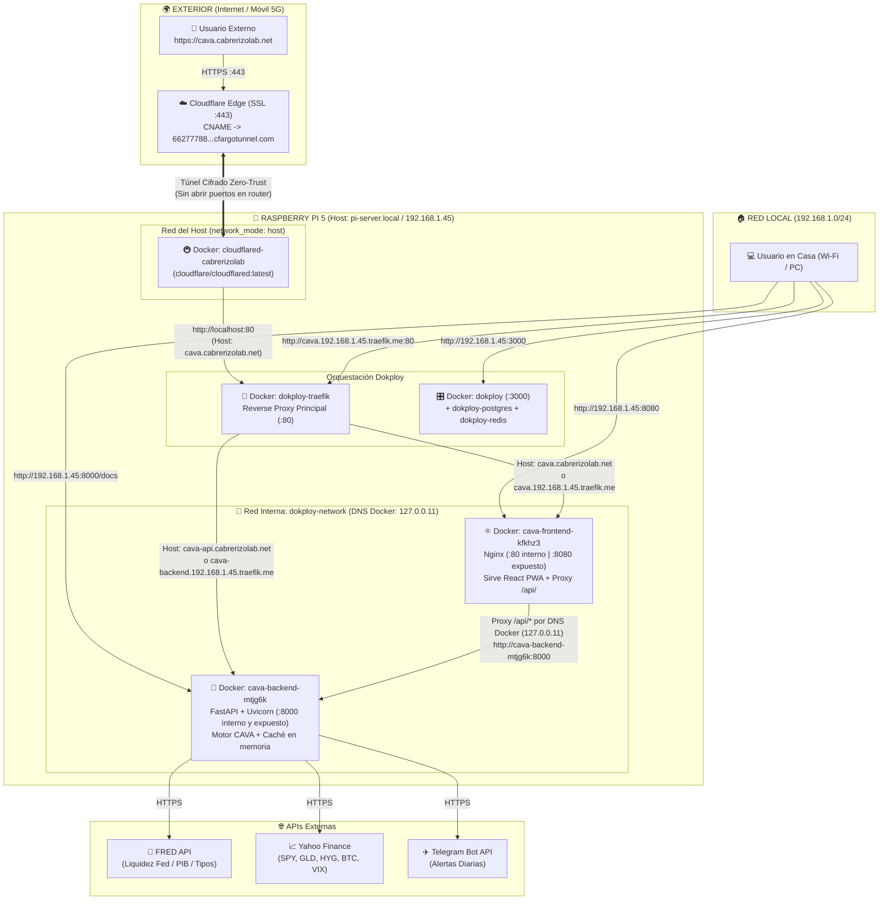

# 🍓 Manual Maestro de Arquitectura y Recuperación: Homelab Raspberry Pi 5 + Dokploy + Cloudflare Zero Trust (`cabrerizolab.net`)

> **Propósito para humanos e IAs:** Este documento contiene el estado técnico completo, identificadores, topología de red, contenedores Docker, proxies, dominios y procedimientos de recuperación ante desastres (*Disaster Recovery*) del servidor Homelab en **Raspberry Pi 5 (8 GB)** donde se aloja el sistema **CAVA Macro Decision System** y futuras aplicaciones. Si se entrega este archivo a cualquier agente de IA junto con el repositorio, tendrá el 100% del contexto necesario para mantener, escalar o reconstruir el servidor desde cero.

---

## 1. Datos Clave del Servidor e Infraestructura

| Parámetro | Valor / Configuración |
| :--- | :--- |
| **Hardware** | Raspberry Pi 5 (8 GB RAM, arquitectura `linux/arm64` / `aarch64`), conectada por Ethernet (`eth0`) |
| **Sistema Operativo** | Raspberry Pi OS Lite (64-bit, Debian Bookworm) — *Headless* (sin entorno gráfico) |
| **Hostname / Usuario SSH** | Hostname: `pi-server` (`pi-server.local`) · Usuario: `cesar` (`ssh cesar@192.168.1.45` o `ssh cesar@pi-server.local`) |
| **IP Local (LAN)** | `192.168.1.45` (Puerta de enlace: `192.168.1.1`) |
| **Protección microSD** | `Log2Ram` instalado y activo (`df -h \| grep log2ram`) para montar `/var/log` en RAM |
| **Plataforma PaaS** | **Dokploy** (basado en Docker Swarm + Traefik + PostgreSQL + Redis) |
| **URL Panel Dokploy** | `http://192.168.1.45:3000` o `http://pi-server.local:3000` |
| **Dominio Oficial Público** | **`cabrerizolab.net`** (gestionado en Cloudflare + Cloudflare Zero Trust Tunnel) |
| **URL Pública Producción CAVA** | **`https://cava.cabrerizolab.net`** (HTTPS con soporte PWA instalable en iOS/Android/PC) |
| **Repositorio GitHub** | `https://github.com/yentini/cava-macro-system-.git` (rama `main`, Auto-Deploy activado) |

---

## 2. Preparación Base del Sistema Operativo (Realizada en la Raspberry Pi)

### A. Actualización de Sistema y EEPROM
```bash
sudo apt update && sudo apt full-upgrade -y && sudo rpi-eeprom-update -a
sudo reboot
```

### B. Instalación de `Log2Ram` (Protección de escritura en microSD)
```bash
echo "deb [signed-by=/usr/share/keyrings/azlux-archive-keyring.gpg] http://packages.azlux.fr/debian/ $(lsb_release -sc) main" | sudo tee /etc/apt/sources.list.d/azlux.list
sudo wget -O /usr/share/keyrings/azlux-archive-keyring.gpg https://azlux.fr/repo.gpg
sudo apt update && sudo apt install log2ram -y
sudo reboot
```

### C. Instalación de Dokploy
```bash
curl -sSL https://dokploy.com/install.sh | sudo sh
```

### D. Fijar IP Estática `192.168.1.45` en NetworkManager (Opcional en Host)
```bash
sudo nmcli connection modify "Wired connection 1" ipv4.addresses 192.168.1.45/24 ipv4.gateway 192.168.1.1 ipv4.dns "1.1.1.1,8.8.8.8" ipv4.method manual && sudo nmcli connection up "Wired connection 1"
```

---

## 3. Inventario Exacto de Servicios en Dokploy (Proyecto `Cava`)

* **Project Name:** `Cava` (`projectId`: `K2b7Zhys7wC5Goq3OVybb`)
* **Environment:** `production` (`environmentId`: `orTJvueD5H-U8L_BWqhf4`)
* **GitHub App Provider ID en Dokploy:** `A6B4uonQgjXermsJI14ts`

### 3.1. Servicio Backend (`backend`)
* **Application ID:** `ufgDk1PgIMXOSC-4WL-4O`
* **App Name (Nombre DNS interno en `dokploy-network`):** `cava-backend-mtjg6k`
* **Origen:** GitHub (`yentini/cava-macro-system-`, rama `main`, `autoDeploy: true`)
* **Build Type:** `dockerfile`
  * **Build Path / Docker Context Path:** `/backend`
  * **Dockerfile:** [`backend/Dockerfile`](file:///c:/Users/ccabrerizo/Documents/ANTIGRAVITY/CAVA/backend/Dockerfile) (imagen base `python:3.12-slim` multi-arch `ARM64`, usuario sin privilegios `appuser`, comando `uvicorn app.main:app --host 0.0.0.0 --port ${PORT:-8000}`)
  * **Ignorados en build:** [`backend/.dockerignore`](file:///c:/Users/ccabrerizo/Documents/ANTIGRAVITY/CAVA/backend/.dockerignore)
* **Variables de Entorno (`Environment` en Dokploy):**
  * `FRED_API_KEY`, `TELEGRAM_BOT_TOKEN`, `TELEGRAM_CHAT_ID` (leídas de [`backend/.env`](file:///c:/Users/ccabrerizo/Documents/ANTIGRAVITY/CAVA/backend/.env))
  * `PORT=8000`
  * `ENVIRONMENT=production`
* **Puertos y Dominios:**
  * Puerto interno del contenedor: `8000`
  * Puerto expuesto en Host (LAN): `8000` (`http://192.168.1.45:8000/api/health`, Swagger en `http://192.168.1.45:8000/docs`)
  * Dominios en Traefik: `cava-api.cabrerizolab.net` (puerto `8000`) y `cava-backend.192.168.1.45.traefik.me` (puerto `8000`)
* **CORS ([`backend/app/main.py`](file:///c:/Users/ccabrerizo/Documents/ANTIGRAVITY/CAVA/backend/app/main.py)):**
  * Permite orígenes de `*.vercel.app`, `*.cabrerizolab.net`, `*.traefik.me`, `pi-server.local`, `192.168.x.x` y `localhost`.

### 3.2. Servicio Frontend (`frontend`)
* **Application ID:** `byaCBRg0DfPS6HnQnpaQx`
* **App Name (Nombre DNS interno en `dokploy-network`):** `cava-frontend-kfkhz3`
* **Origen:** GitHub (`yentini/cava-macro-system-`, rama `main`, `autoDeploy: true`)
* **Build Type:** `dockerfile`
  * **Build Path / Docker Context Path:** `/frontend`
  * **Dockerfile:** [`frontend/Dockerfile`](file:///c:/Users/ccabrerizo/Documents/ANTIGRAVITY/CAVA/frontend/Dockerfile) (multi-stage: `node:20-alpine` compila Vite/React y `nginx:alpine` sirve estáticos en puerto `80`)
  * **Configuración Nginx ([`frontend/nginx.conf`](file:///c:/Users/ccabrerizo/Documents/ANTIGRAVITY/CAVA/frontend/nginx.conf)):**
    * Sirve la SPA de React con `try_files $uri $uri/ /index.html;`.
    * **Reverse Proxy Interno Resiliente:** Redirige `/api/*` hacia `http://cava-backend-mtjg6k:8000` usando el servidor DNS interno de Docker (`resolver 127.0.0.11 valid=30s ipv6=off;`). De este modo, la comunicación Frontend ➔ Backend ocurre íntegramente dentro de `dokploy-network` y **no depende de la IP local del router (`192.168.1.45`)**.
* **Puertos y Dominios:**
  * Puerto interno del contenedor: `80`
  * Puerto expuesto en Host (LAN): `8080` (`http://192.168.1.45:8080/`)
  * Dominios en Traefik: **`cava.cabrerizolab.net`** (puerto `80`, `https: false` en Traefik porque Cloudflare gestiona el SSL en el borde) y `cava.192.168.1.45.traefik.me` (puerto `80`).

### 3.3. Servicio Cloudflare Zero Trust Tunnel (`cloudflare-tunnel`)
* **Compose ID:** `Q5eXJcN9JBpX4CbtdB--v`
* **Tipo:** Servicio `docker-compose` (*Raw*) en Dokploy
* **Tunnel ID en Cloudflare:** `66277788-64a6-4268-a48c-e0c21371cba0` (`66277788-64a6-4268-a48c-e0c21371cba0.cfargotunnel.com`)
* **Definición `docker-compose.yml` desplegada:**
  ```yaml
  services:
    cloudflared:
      image: cloudflare/cloudflared:latest
      container_name: cloudflared-cabrerizolab
      restart: unless-stopped
      network_mode: host
      command: tunnel --no-autoupdate run --token <CLOUDFLARE_TUNNEL_TOKEN>
  ```
* **Ventaja de `network_mode: host`:** El contenedor comparte la pila de red de la Raspberry Pi, permitiendo que en el panel de Cloudflare Zero Trust (*Networks ➔ Tunnels ➔ Published application routes*) la ruta de `cava.cabrerizolab.net` apunte a **`http://localhost:80`** (además de `http://192.168.1.45:80`), siendo **100% inmune a cambios de IP del router**.

### 3.4. Convivencia con Render y Vercel
* Los archivos [`backend/Dockerfile`](file:///c:/Users/ccabrerizo/Documents/ANTIGRAVITY/CAVA/backend/Dockerfile), [`frontend/Dockerfile`](file:///c:/Users/ccabrerizo/Documents/ANTIGRAVITY/CAVA/frontend/Dockerfile) y [`frontend/nginx.conf`](file:///c:/Users/ccabrerizo/Documents/ANTIGRAVITY/CAVA/frontend/nginx.conf) **no afectan a Render ni a Vercel**:
  * Render lee [`render.yaml`](file:///c:/Users/ccabrerizo/Documents/ANTIGRAVITY/CAVA/render.yaml) (`runtime: python` nativo).
  * Vercel lee [`frontend/vercel.json`](file:///c:/Users/ccabrerizo/Documents/ANTIGRAVITY/CAVA/frontend/vercel.json) y `package.json` (`Vite` preset).

---

## 4. Diagrama de Arquitectura Completa (Contenedores, Proxies, IPs y Puertos)



---

## 5. Cómo Añadir Nuevas Aplicaciones en el Futuro (30 segundos)

Gracias a que `cloudflare-tunnel` y `dokploy-traefik` ya están conectados en el puerto `80`:
1. **En Dokploy (`http://192.168.1.45:3000`):** Creas el proyecto/aplicación, vas a la pestaña **Domains** y añades `nueva-app.cabrerizolab.net` apuntando al puerto interno del contenedor (con el switch `HTTPS` desactivado, ya que Cloudflare aplica HTTPS automáticamente).
2. **En Cloudflare Zero Trust ([one.dash.cloudflare.com](https://one.dash.cloudflare.com/) ➔ `Networks` ➔ `Tunnels` ➔ `Add route`):**
   * **Subdomain:** `nueva-app` · **Domain:** `cabrerizolab.net`
   * **Service URL:** `http://localhost:80`

---

## 6. Plan de Recuperación ante Desastres (*Disaster Recovery*) y Migración a SSD NVMe

### A. Reconstrucción Automática en 1 Clic (`backups/restore_dokploy.py`)
Si la tarjeta microSD fallase y hubiera que instalar Dokploy desde cero en una tarjeta o disco nuevo:
1. Generar un nuevo token de API en el panel recién instalado de Dokploy (**Settings ➔ Profile ➔ API/CLI**) y actualizar `DOKPLOY_API_KEY` en el archivo local [`backups/.secrets.env`](file:///c:/Users/ccabrerizo/Documents/ANTIGRAVITY/CAVA/backups/.secrets.env) (ignorado por Git).
2. Ejecutar desde el PC:
   ```powershell
   .\backend\venv\Scripts\python.exe backups/restore_dokploy.py
   ```
3. El script [`backups/restore_dokploy.py`](file:///c:/Users/ccabrerizo/Documents/ANTIGRAVITY/CAVA/backups/restore_dokploy.py) recrea automáticamente por API el proyecto `Cava`, el `backend` (con las claves de [`backend/.env`](file:///c:/Users/ccabrerizo/Documents/ANTIGRAVITY/CAVA/backend/.env)), el `frontend` (con el dominio `cava.cabrerizolab.net`), los puertos `8000` y `8080` y el contenedor `cloudflare-tunnel` con el mismo token de Cloudflare. En ~60 segundos **`https://cava.cabrerizolab.net`** vuelve a estar operativo sin tocar Cloudflare.

### B. Volcado Manual de la Base de Datos Interna de Dokploy (Opcional)
```powershell
ssh cesar@192.168.1.45 "sudo docker exec $(sudo docker ps -q -f name=dokploy-postgres) pg_dump -U dokploy dokploy" > backups/dokploy_backup.sql
```

### C. Migración en Caliente de microSD a SSD NVMe (`rpi-clone`) sin Perder Nada
* **Hardware recomendado:**
  * *Opción Oficial (2230):* **Raspberry Pi SSD Kit Oficial 512 GB (`SC1676`)** (incluye placa M.2 HAT+ y SSD NVMe oficial).
  * *Opción Estándar (2280):* Adaptador **Geekworm X1001 / X1002 (o Pimoroni NVMe Base)** + SSD NVMe **Kioxia Exceria G2 1 TB** o **Samsung 980 / 970 EVO Plus** *(evitar Kingston NV1/NV2 y WD Blue SN550/SN570)*.
* **Pasos de clonación en caliente por SSH:**
  1. Conectar el HAT PCIe + SSD NVMe a la Raspberry Pi 5 y encender normalmente desde la microSD actual.
  2. Instalar `rpi-clone` y clonar el sistema en vivo hacia `nvme0n1`:
     ```bash
     curl https://raw.githubusercontent.com/geerlingguy/rpi-clone/master/install | sudo bash
     sudo rpi-clone nvme0n1
     ```
  3. Cambiar el orden de arranque en la EEPROM ejecutando `sudo raspi-config` ➔ `6 Advanced Options` ➔ `A4 Boot Order` ➔ `B2 NVMe/USB Boot`.
  4. Apagar con `sudo poweroff`, **extraer la tarjeta microSD** (guardarla en un cajón como copia física exacta de emergencia) y encender la Raspberry Pi 5 para arrancar directamente desde el SSD NVMe.
