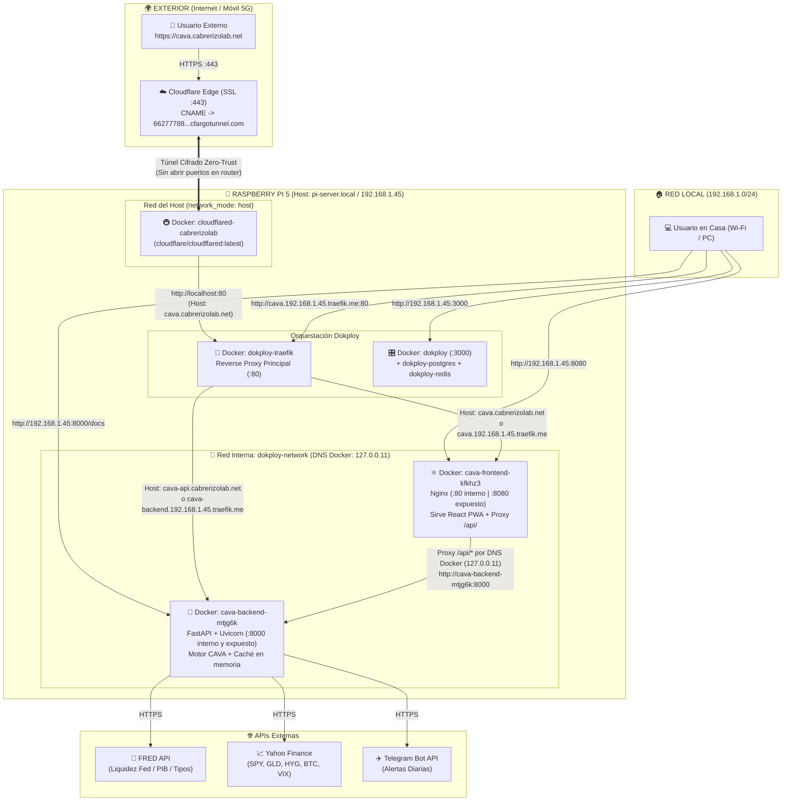

# Resumen de Configuración: Homelab en Raspberry Pi 5 (8GB) con Dokploy

Este documento resume la arquitectura, decisiones y pasos técnicos realizados para transformar tu Raspberry Pi 5 de 8 GB en un servidor privado autoalojado (*Self-Hosted PaaS*, estilo Vercel/Render en casa) para tus aplicaciones y bases de datos.

---

## 1. Decisiones de Arquitectura y Alcance

* **Hardware:** Raspberry Pi 5 de 8 GB de RAM (conectada por cable Ethernet al router).
* **Almacenamiento:** Tarjeta microSD temporal (con previsión futura de migración a SSD NVMe mediante clonación en caliente si fuera necesario).
* **Enfoque Descartado (Chatbots locales por WhatsApp):** Se evaluó montar modelos de lenguaje local (Ollama, Llama, Qwen, Gemma) conectados a WhatsApp, pero se desestimó para un uso diario por limitaciones de velocidad y ergonomía frente a herramientas nativas en la nube.
* **Enfoque Elegido (PaaS Privado):** Uso de la Raspberry Pi como un servidor de despliegue continuo 24/7 y gestión de bases de datos mediante **Dokploy**.

---

## 2. Paso a Paso Realizado en el Servidor (Raspberry Pi OS Lite 64-bit)

### A. Preparación del Sistema (Headless via SSH)
1. **Grabación de la tarjeta:** Uso de *Raspberry Pi Imager* seleccionando `Raspberry Pi OS Lite (64-bit)`, configurando el usuario `cesar`, habilitando el servicio SSH y ajustando el *Hostname* a `pi-server`.
2. **Conexión SSH inicial:**
   ```powershell
   ssh cesar@pi-server.local
   ```
   *(Nota: Se limpió la huella previa con `ssh-keygen -R pi-server.local` debido a una instalación anterior).*

### B. Actualización de Sistema y Firmware
1. Actualización de paquetes de sistema y del firmware de la placa (EEPROM):
   ```bash
   sudo apt update && sudo apt full-upgrade -y && sudo rpi-eeprom-update -a
   ```
2. Reinicio posterior para aplicar cambios del kernel y firmware (`sudo reboot`).

### C. Protección de la tarjeta MicroSD (`Log2Ram`)
Para evitar el desgaste prematuro de la tarjeta microSD debido a las constantes escrituras de logs del sistema y de Docker, se instaló la utilidad `Log2Ram`:
```bash
echo "deb [signed-by=/usr/share/keyrings/azlux-archive-keyring.gpg] http://packages.azlux.fr/debian/ $(lsb_release -sc) main" | sudo tee /etc/apt/sources.list.d/azlux.list
sudo wget -O /usr/share/keyrings/azlux-archive-keyring.gpg https://azlux.fr/repo.gpg
sudo apt update && sudo apt install log2ram -y
```
*(Verificado mediante `df -h | grep log2ram` tras el reinicio).*

### D. Instalación de Dokploy (PaaS Autoalojado)
Se instaló el panel gestor de contenedores y despliegues automáticos (Docker, Traefik, Docker Swarm y Dokploy):
```bash
curl -sSL https://dokploy.com/install.sh | sudo sh
```
* **Estado actual:** Panel web activo y accesible localmente en `http://pi-server.local:3000` (o mediante la IP local asignada por tu router). Cuenta de administrador creada y lista para conectar repositorios de GitHub o bases de datos.

---

## 3. Despliegue de CAVA y Acceso Público (`cabrerizolab.net`)
1. **Backend (`cava-backend`):** Desplegado en Dokploy mediante [`backend/Dockerfile`](file:///c:/Users/ccabrerizo/Documents/ANTIGRAVITY/CAVA/backend/Dockerfile) (`python:3.12-slim` ARM64) en el puerto `8000` (`http://192.168.1.45:8000` y `http://cava-backend.192.168.1.45.traefik.me`).
2. **Frontend (`cava-frontend`):** Desplegado en Dokploy mediante [`frontend/Dockerfile`](file:///c:/Users/ccabrerizo/Documents/ANTIGRAVITY/CAVA/frontend/Dockerfile) (`node:20-alpine` + `nginx:alpine`) con reverse proxy integrado en [`frontend/nginx.conf`](file:///c:/Users/ccabrerizo/Documents/ANTIGRAVITY/CAVA/frontend/nginx.conf) (`/api/` ➔ `http://cava-backend-mtjg6k:8000` por DNS interno de Docker `127.0.0.11`).
3. **Cloudflare Zero Trust Tunnel (`cloudflare-tunnel`):** Contenedor `cloudflare/cloudflared:latest` con `network_mode: host` ejecutándose en Dokploy y enrutando el dominio oficial **`https://cava.cabrerizolab.net`** hacia Traefik (`http://localhost:80` / `http://192.168.1.45:80`) sin abrir puertos en el router.

---

## 4. Diagrama de Arquitectura Completa (Contenedores, Proxies, IPs y Puertos)



---

## 5. Backup de Dokploy y Migración Futura de microSD a SSD NVMe

### A. Copia de Seguridad de la Base de Datos de Dokploy (desde Windows)
```powershell
ssh cesar@192.168.1.45 "sudo docker exec $(sudo docker ps -q -f name=dokploy-postgres) pg_dump -U dokploy dokploy" > dokploy_backup.sql
```

### B. Clonación en Caliente de microSD a SSD NVMe (`rpi-clone`)
1. Conectar el HAT PCIe + SSD NVMe y arrancar normalmente desde la microSD.
2. Instalar `rpi-clone` y clonar el sistema activo hacia `nvme0n1`:
   ```bash
   curl https://raw.githubusercontent.com/geerlingguy/rpi-clone/master/install | sudo bash
   sudo rpi-clone nvme0n1
   ```
3. Cambiar el orden de arranque en la EEPROM (`sudo raspi-config` ➔ `6 Advanced Options` ➔ `A4 Boot Order` ➔ `B2 NVMe/USB Boot`), apagar (`sudo poweroff`), retirar la microSD (que queda como copia física de emergencia) y encender.